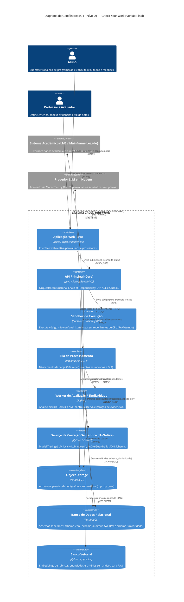

# Projeto Architectural Kata — Check Your Work (Versão Definitiva)

**Disciplina:** Arquitetura de Software | **Período:** 6º Período — Engenharia de Software (UniSenai)  
**Turma:** Quarta-feira | **Sprint / Entrega:** Sprint 4 — Entrega Final Consolidada (Sprints 1 a 4)  
**Equipe:** Sysops

---

## Identificação da Equipe

| Nome do Integrante | Função na Sprint 4 (Liderança / Pesquisador / Executor) | GitHub |
| :--- | :--- | :--- |
| Emilio Rodrigues | Líder & Arquiteto Principal | `@EmilioRodri` |
| João Nicolas | Pesquisador & Modelagem DDD | `@scarlrxrd` |
| Gabriel | Pesquisador & Engenheiro de Resiliência & Integração | `@GabrielHenrrique661` |
| Marcell Klug Dias | Executor & Especialista em IA-Native & Autonomia | `@CorvoBlackHand` |
| Leonardo Hamilton | Executor & QA & Desenvolvedor de Fitness Functions | `@leohamil31` |

---

## 1. Visão Geral do Sistema e Domínio de Negócio

### 1.1. Contexto do Projeto — Check Your Work
O **Check Your Work** é uma plataforma universitária de correção automatizada de trabalhos de programação, detecção explicável de similaridade e avaliação semântica assistida por IA, integrada a um **Sistema Acadêmico (LMS / Mainframe Legado)** cujo núcleo não pode ser modificado. O verdadeiro desafio do projeto não se resume a compilar código, mas a garantir **confiança institucional**: isolar a execução de código não confiável de alunos, cumprir a LGPD (tratando código associado à matrícula como dado pessoal), manter trilhas de auditoria imutáveis para recursos acadêmicos e suportar picos de entrega à meia-noite sem derrubar o sistema legado.

* **Desafio Final (Sprint 4):** Evoluir a arquitetura distribuída consolidada nas Sprints 1 a 3 para suportar correção semântica e análise de código via IA Generativa (LLM/SLM com RAG), mantendo tolerância a falhas na integração com o LMS legado e governança estrutural automatizada via *Fitness Functions*.
* **Entregáveis Chave:** Diagramas C4 (Contexto e Contêineres com IA-Native e Banco Vetorial), Modelagem DDD e Soberania de Dados, Catálogo SOLID/GoF, Matriz QAW e BOTE, ADRs consolidados (001 a 006) e testes automatizados de arquitetura (ArchUnit).

### 1.2. Resumo da Solução Proposta
Ao longo do semestre, a arquitetura evoluiu de um desenho inicial monolítico e altamente acoplado para uma **arquitetura distribuída baseada em contêineres especializados**, preservando internamente a **Arquitetura em Camadas com Inversão de Dependência (DIP)** e os princípios **SOLID** no núcleo da aplicação. A segregação física em contêineres independentes — **Aplicação Web (SPA)**, **API Principal (REST)**, **Sandbox de Execução**, **Worker de Avaliação/Similaridade** e **Serviço de Correção Semântica (IA-Native)** — reduz a superfície de ataque ao isolar códigos arbitrários de alunos e desacopla processamentos pesados do fluxo interativo de submissão.

A comunicação adota uma estratégia híbrida orientada ao perfil de risco e latência de cada fluxo: **REST/HTTPS** entre a SPA e a API Principal (com validação em Cadeia de Responsabilidades); **gRPC** de baixa latência e contrato tipado entre a API e a Sandbox *stateless*; e mensageria assíncrona **AMQP (RabbitMQ)** para nivelamento de carga do Worker de Similaridade e do Serviço de IA. A persistência combina **Object Storage (Amazon S3)** para pacotes de código, **PostgreSQL** particionado logicamente em *schemas* soberanos (`schema_core`, `schema_auditoria` em modo WORM/*append-only* e `schema_similaridade`) e um **Banco Vetorial** dedicado a *embeddings* de rubricas e padrões de código para RAG.

A fronteira com o **LMS / Mainframe Legado** é protegida por uma **Camada Anti-Corrupção (ACL)** implementada com o padrão *Adapter*, blindada por **Timeout (1s)**, **2 retentativas com backoff exponencial e jitter**, **Circuit Breaker** (janela de 20 chamadas, abertura com 50% de falhas por 30 segundos) e padrão **Outbox** (`PENDENTE_PUBLICACAO` com `idempotency_key`). Na camada de IA-Native, a estratégia de **Model Tiering** (SLM local para triagem e LLM em nuvem para casos complexos) atua sob *guardrails* de higienização de PII e validação por JSON Schema, mantendo a **revisão humana obrigatória** para qualquer suspeita de plágio ou contestação de nota.

---

## 2. Drivers Arquiteturais, Matriz QAW e Capacidade (BOTE)

### 2.1. Drivers Prioritários e Conformidade Legal (LGPD)
Os atributos de qualidade foram priorizados para blindar o projeto contra falhas críticas que inviabilizariam sua adoção institucional:
* **Prioridade 1 — Segurança e Privacidade (LGPD):** Código-fonte vinculado à matrícula/turma é dado pessoal protegido; exige minimização na coleta, quarentena na execução (Sandbox sem rede) e ciclo documentado de retenção.
* **Prioridade 2 — Integridade e Auditabilidade:** Toda alteração ou revisão de nota gera registro imutável (*append-only* / WORM) com usuário, data/hora, motivo, valor anterior e versão; similaridade é apoio à decisão docente, nunca punição automática.
* **Prioridade 3 — Integração Confiável com o Legado:** Publicação idempotente de notas sem alterar o núcleo do LMS/mainframe, absorvendo picos e quedas externas.

### 2.2. Matriz de Cenários de Qualidade (QAW)

| Atributo de Qualidade | Cenário Padronizado (Fonte -> Estímulo -> Artefato -> Ambiente -> Resposta) | Medida da Resposta (Métrica Objetivo) |
| :--- | :--- | :--- |
| **Desempenho e Resiliência (QAW-01)** | Alunos concorrentes enviam trabalhos simultaneamente no pico de entrega à meia-noite sobre a API REST e mensageria. | 99,9% das requisições aceitas em < 2s (latência p95 < 250ms na confirmação) com enfileiramento durável e ID idempotente. |
| **Integridade e Auditoria (QAW-02)** | Professor ou administrador revisa ou altera uma nota durante o período de recurso acadêmico em produção. | Registro imutável (*append-only*) preservando valor anterior, novo valor, autor, motivo e versão sem sobrescrita. |
| **Segurança e Isolamento (QAW-03)** | Aluno submete código malicioso (loop infinito, consumo excessivo de RAM ou tentativa de saída de rede) na Sandbox. | Execução contida sem rede externa e sem acesso ao PostgreSQL; limites de CPU/memória/tempo isolam a falha apenas ao job atual. |
| **Disponibilidade na Integração LMS** | Queda ou lentidão severa no LMS/Mainframe legado durante a publicação de notas em lote. | *Circuit Breaker* abre após 50% de falhas em 20 chamadas (por 30s) e *Outbox* grava pendências como `PENDENTE_PUBLICACAO` sem indisponibilizar a UI. |
| **Manutenibilidade e Estabilidade** | Inclusão de nova linguagem no Sandbox, novo algoritmo de similaridade ou troca de provedor LLM. | Domínio mantém Instabilidade I = 0 (Ce = 0) validada continuamente via *Fitness Functions* (ArchUnit) no CI. |

### 2.3. Análise de Capacidade (BOTE — Projeção de 5 Anos)
* **Base Acadêmica (Ano 1):** 10.000 estudantes ativos × 6 trabalhos × 2 semestres = **120.000 submissões/ano**.
* **Anatomia do Dado:** 250 KB (pacote de código) + 100 KB (metadados/logs) = **350 KB brutos por submissão**.
* **Projeção Acumulada (5 Anos):** Crescimento composto de 10% a.a., atingindo **732.852 submissões acumuladas**.
* **Armazenamento Planejado:** ~256,5 GB lógicos brutos × fator 3x (índices, cópias, backups e auditoria WORM) = **1 TB de Storage planejado**.
* **Throughput de Pico:** **10 req/s** sustentados na janela crítica (absorvendo 30% do volume semestral concentrado em 2 horas).

---

## 3. Visão Geral da Arquitetura (Modelo C4)

A documentação visual mantém coerência de nomenclatura, legenda e direção de fluxo em todos os níveis:
* 📄 **Nível 1 — Diagrama de Contexto:** [`docs/c4/Diagrama1jpeg.jpeg`](docs/c4/Diagrama1jpeg.jpeg)
* 📄 **Nível 2 — Diagrama de Contêineres (Base Sprints 1–3):** [`docs/c4/Diagrama2.jpeg`](docs/c4/Diagrama2.jpeg)
* 📄 **Nível 2 — Diagrama de Contêineres Evoluído (Sprint 4 — com IA-Native e Banco Vetorial):** apresentado abaixo em Mermaid.
* 📄 **Nível 3 — Diagrama de Componentes / UML (DIP):** [`docs/c4/03-componentes.md`](docs/c4/03-componentes.md)

### Visualização do Diagrama de Contêineres (C4 - Nível 2 — Sprint 4)



---

## 4. Domain-Driven Design (DDD), Limites de Contexto e Soberania de Dados

### 4.1. Classificação dos Subdomínios
* **Core Domain (Domínio Principal):** Motor de Correção e Avaliação (`CorrigirSubmissao`, execução em Sandbox, análise híbrida de similaridade Léxica + AST e correção semântica assistida por IA).
* **Supporting Subdomain (Suporte):** Gestão de Submissões, Trilha de Auditoria Imutável (WORM / *append-only*) e Publicação Confiável via Outbox (`PENDENTE_PUBLICACAO`).
* **Generic Subdomain (Genérico):** Autenticação/Autorização (SSO), Armazenamento de Objetos (S3) e Mensageria/Observabilidade.

### 4.2. Camada Anti-Corrupção (ACL)
Toda integração com o **LMS / Mainframe Legado** é encapsulada por uma **Camada Anti-Corrupção (ACL)** implementada pelo padrão *Adapter* (`PublicadorNotaLMS` / `LmsAdapter`), traduzindo os contratos legados para os DTOs do domínio e garantindo publicação idempotente e auditável sem contaminar a Linguagem Ubíqua.

### 4.3. Distribuição de Dados e Soberania dos Módulos (PostgreSQL)
Para evitar acoplamento oculto por banco compartilhado, o PostgreSQL é particionado em *schemas* lógicos independentes com *roles* segregadas por módulo:

| Módulo / Contêiner | Armazenamento | Tabelas Principais | Responsabilidade e Soberania |
| :--- | :--- | :--- | :--- |
| **API Principal (Core)** | PostgreSQL (`schema_core`) | `submissoes`, `resultados`, `outbox_publicacao_lms` | Dona do ciclo de vida da submissão, consolidação de notas e fila Outbox (`idempotency_key` única e status `PENDENTE_PUBLICACAO`). |
| **Auditoria** | PostgreSQL (`schema_auditoria`) | `auditoria_eventos` | Registro *append-only* (WORM) de usuário, data, motivo e versão da nota; *role* sem permissão de `UPDATE`/`DELETE`. |
| **Worker de Similaridade** | PostgreSQL (`schema_similaridade`) | `acervo_submissoes`, `evidencias_similaridade` | Dono do acervo tokenizado e das evidências de plágio; não executa `SELECT` no `schema_core` (recebe payload via AMQP). |
| **Sandbox (Execução)** | *Stateless* (Efêmero) | Nenhuma tabela persistente | Sem drivers, credenciais ou rota de rede para o PostgreSQL, reduzindo a superfície de ataque. |

---

## 5. Padrões de Projeto, Princípios SOLID e Métricas Estruturais

### 5.1. Princípios SOLID e Diagnóstico Quantitativo (Robert C. Martin)
A refatoração orientada pelo **Princípio da Inversão de Dependência (DIP)** isolou o núcleo de negócio por meio de **5 interfaces abstratas principais**: `RepositorioSubmissao`, `ExecutorDeCodigo`, `AnalisadorSimilaridade`, `PublicadorNota` e `Auditoria`. A validação matemática pelas métricas de Robert C. Martin (`I = Ce / (Ca + Ce)`, `A = Na / Nc`, `D = |A + I - 1|`) comprovou a **Regra de Ouro da Estabilidade** (dependências apontando exclusivamente de camadas voláteis para o Domínio):

| Pacote | Nc | Na | Ca | Ce | Instabilidade (I) | Abstracionalidade (A) | Distância (D) | Diagnóstico |
| :--- | :---: | :---: | :---: | :---: | :---: | :---: | :---: | :--- |
| **Presentation** | 1 | 0 | 0 | 1 | 1,0 | 0,0 | 0,0 | Sequência Principal |
| **Domain** | 10 | 5 | 6 | 0 | 0,0 | 0,5 | 0,5 | Estável / Rigidez Pragmática Aceita |
| **Infrastructure** | 5 | 0 | 0 | 5 | 1,0 | 0,0 | 0,0 | Sequência Principal |

O pacote `Domain` apresenta estabilidade máxima (`I = 0,0`, `Ce = 0`) e não está na *Zona de Dor* (que exigiria `I ≈ 0` e `A ≈ 0` simultaneamente); a rigidez parcial (`A = 0,5`, `D = 0,5`) decorrente das entidades/DTOs concretos (`Submissao`, `ResultadoExecucao`, `Evidencias`, `Resultado`) foi registrada como trade-off pragmático aceito e monitorado.

### 5.2. Catálogo de Padrões GoF e Apresentação Aplicados

| Padrão | Categoria | Aplicação Concreta no Check Your Work | Problema Resolvido |
| :--- | :--- | :--- | :--- |
| **Factory Method** | GoF Criacional | `ExecutorFactory` (`ExecutorPython`, `ExecutorJava`) | Instanciação polimórfica de executores por linguagem sem acoplar o caso de uso ao operador `new`. |
| **Abstract Factory / Builder** | GoF Criacional | `ResultadoCorrecaoBuilder` / Fábricas de integração | Construção validada de objetos complexos (invariantes de nota 0–10) e famílias coordenadas de conectores. |
| **Singleton** | GoF Criacional | Estado compartilhado de configuração / Circuit Breaker via DI | Consistência de parâmetros globais sem perda de testabilidade. |
| **Adapter** | GoF Estrutural | `PublicadorNotaLMS` (`LmsAdapter`) | Camada Anti-Corrupção (ACL) traduzindo contratos do LMS legado para o domínio. |
| **Decorator** | GoF Estrutural | `PublicadorNotaResilienteDecorator` | Anexa Timeout, Retry com backoff/jitter e Circuit Breaker ao publicador sem poluir a regra de negócio. |
| **Facade / Proxy** | GoF Estrutural | `CorrigirSubmissaoUseCase` (Facade) e Stub gRPC (Proxy) | Unifica a orquestração do fluxo de correção para o Controller e encapsula a chamada remota à Sandbox. |
| **Strategy** | GoF Comportamental | Estratégias de execução, similaridade híbrida e *Model Tiering* | Elimina condicionais `if/else` rígidas, respeitando o OCP. |
| **Chain of Responsibility** | GoF Comportamental | Middlewares de validação de submissão | Valida autenticação, `Idempotency-Key`, schema, tamanho e prazo em cadeia extensível. |
| **State / Command / Observer** | GoF Comportamental | Máquina de estados do Circuit Breaker; fila `PENDENTE_PUBLICACAO`; eventos AMQP | Controla transições (`FECHADO`, `ABERTO`, `MEIO_ABERTO`), enfileira pendências de nota e dispara auditoria/similaridade desacopladas. |
| **MVC / MVP / MVVM** | Apresentação | API REST (MVC) e SPA React/TypeScript (MVVM/MVP) | Separa roteamento/serialização OpenAPI no servidor e atualização reativa de status na interface web. |

---

## 6. Resiliência, Segurança do Sandbox e IA-Native

### 6.1. Padrões de Resiliência e Isolamento
* **Política de Resiliência no LMS (REST/HTTPS):** Timeout estrito de **1 segundo**, **2 retentativas** com *backoff* exponencial e *jitter*, e **Circuit Breaker** com janela de **20 chamadas**, abertura ao atingir **50% de falhas** e permanência aberto por **30 segundos** antes da sondagem em estado semiaberto.
* **Outbox e Consistência Eventual:** Em caso de falha ou circuito aberto, a nota é gravada em `schema_core.outbox_publicacao_lms` com status `PENDENTE_PUBLICACAO` e `idempotency_key` única, garantindo entrega *at-least-once* com reconciliação idempotente.
* **Nivelamento de Carga (AMQP + DLQ):** Filas duráveis no RabbitMQ absorvem picos de submissão (10+ req/s), com *Dead Letter Queue* (DLQ) para mensagens com falha persistente.
* **Controles de Segurança da Sandbox (gRPC):** Execução sob usuário sem privilégios, sistema de arquivos restrito e efêmero, limites rígidos de CPU, memória, tempo, processos e tamanho de saída, bloqueio total de rede de saída por padrão e ausência de segredos ou rota para o banco de dados.

### 6.2. Componente de Inteligência Artificial Generativa (IA-Native)
* **Arquitetura RAG + Model Tiering:** O serviço de correção semântica consulta o **Banco Vetorial** (RAG) para recuperar rubricas de avaliação, casos de borda e gabaritos conceituais, complementando a análise híbrida de similaridade (Léxica + AST). O roteamento segue dois níveis:
  * **Tier 1 (SLM Local):** Modelos compactos locais executam feedback inicial, análise de legibilidade e verificação de boas práticas com baixo custo e latência previsível sob pico.
  * **Tier 2 (LLM em Nuvem):** Acionado apenas quando o SLM retorna baixa confiança ou o exercício exige avaliação semântica profunda.
* **Guardrails, Privacidade (LGPD) e Governança:** Higienização prévia de PII (remoção de nome, matrícula e e-mail do aluno nos comentários do código) antes de qualquer chamada externa; proteção contra *prompt injection* embutido no código submetido; validação obrigatória das respostas via **JSON Schema**; e manutenção da **revisão humana obrigatória** pelo professor para qualquer penalidade ou ajuste de nota.

---

## 7. Registros de Decisões Arquiteturais (ADRs)

Todas as decisões arquiteturais e seus trade-offs estão consolidados na raiz do repositório. A validação cruzada da equipe está em [VALIDACAO.md](VALIDACAO.md):

| ADR | Título da Decisão Arquitetural | Responsável | Status |
| :--- | :--- | :--- | :---: |
| [ADR-001](ADR-001-estilo-arquitetural-acl.md) | Processamento Assíncrono (AMQP) + Camada Anti-Corrupção (ACL/Adapter) para Proteção do LMS Legado | Emilio Rodrigues | Aprovado |
| [ADR-002](ADR-002-conteineres-resiliencia.md) | Contêineres Especializados, Comunicação Híbrida (REST, gRPC, AMQP) e Resiliência (Circuit Breaker + Outbox) | Gabriel | Aprovado |
| [ADR-003](ADR-003-dip-auditoria-worm.md) | Refatoração com DIP, Aceite Pragmático da Rigidez do Domínio (A = 0,5) e Auditoria Imutável WORM + Revisão Humana | Emilio Rodrigues | Aprovado |
| [ADR-004](ADR-004-ddd-soberania-dados.md) | Distribuição de Dados e Soberania por Schemas Isolados no PostgreSQL (`schema_core`, `schema_auditoria`, `schema_similaridade`) | João Nicolas | Aprovado |
| [ADR-005](ADR-005-padroes-gof-apresentacao.md) | Catálogo Tático de Padrões GoF (Criacionais, Estruturais e Comportamentais) e Padrões de Apresentação (MVC/MVVM) | Leonardo Hamilton | Aprovado |
| [ADR-006](ADR-006-ia-native-model-tiering.md) | Arquitetura IA-Native: *Model Tiering* (SLM Local vs. LLM em Nuvem), RAG Vetorial e Guardrails LGPD/JSON Schema | Marcell Klug Dias | Aprovado |

---

## 8. Testes & Fitness Functions (Governança Automatizada)

### 8.1. Execução das Fitness Functions (ArchUnit)
Para impedir a erosão arquitetural e assegurar automaticamente no pipeline CI que a **Regra de Ouro da Estabilidade** (`Ce = 0` no Domínio) nunca seja violada, foram definidas *Fitness Functions* com **ArchUnit**:

* **Regra Validada 1:** O pacote `..domain..` não pode depender de `..infrastructure..` nem de `..presentation..`.
* **Regra Validada 2:** Todas as classes de adaptadores e repositórios em `..infrastructure..` devem implementar as interfaces abstratas declaradas em `..domain.ports..`.
* **Regra Validada 3:** O pacote de execução isolada (`Sandbox`) não possui dependências de drivers JDBC/JPA ou repositórios de banco de dados.

```java
@AnalyzeClasses(packages = "br.com.checkyourwork")
public class ArquiteturaFitnessFunctionsTest {

    @ArchTest
    static final ArchRule dominio_nao_deve_depender_de_infraestrutura_ou_apresentacao =
        noClasses()
            .that().resideInAPackage("..domain..")
            .should().dependOnClassesThat()
            .resideInAnyPackage("..infrastructure..", "..presentation..");

    @ArchTest
    static final ArchRule infraestrutura_deve_implementar_portas_do_dominio =
        classes()
            .that().resideInAPackage("..infrastructure.adapters..")
            .should().beAssignableTo(
                resideInAPackage("..domain.ports..")
            );

    @ArchTest
    static final ArchRule sandbox_nao_deve_acessar_camada_de_persistencia =
        noClasses()
            .that().resideInAPackage("..sandbox..")
            .should().dependOnClassesThat()
            .resideInAnyPackage("java.sql..", "jakarta.persistence..", "..repository..");
}
```

---

## 9. Referências Bibliográficas

* BASS, Len; CLEMENTS, Paul; KAZMAN, Rick. *Software Architecture in Practice*. 4. ed. Boston: Addison-Wesley, 2021.
* FOWLER, Martin. *Patterns of Enterprise Application Architecture*. Boston: Addison-Wesley, 2002.
* GAMMA, Erich et al. *Design Patterns: Elements of Reusable Object-Oriented Software*. Addison-Wesley, 1994.
* MARTIN, Robert C. *Clean Architecture: A Craftsman's Guide to Software Structure and Design*. Prentice Hall, 2017.
* RICHARDS, Mark; FORD, Neal. *Fundamentals of Software Architecture: An Engineering Approach*. Sebastopol: O'Reilly Media, 2020.
* RICHARDSON, Chris. *Microservices Patterns: With Examples in Java*. Shelter Island: Manning, 2018.
